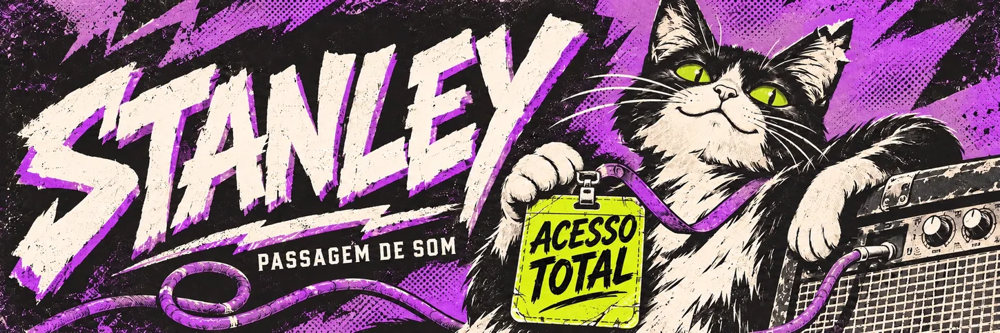
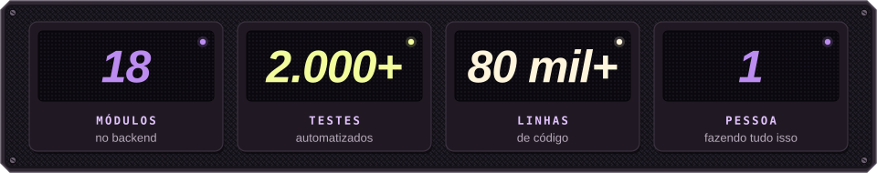
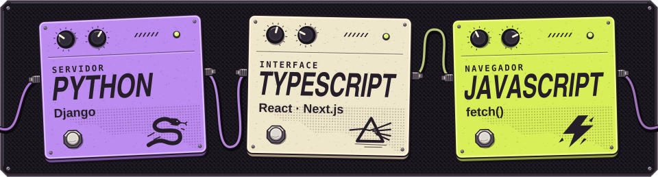
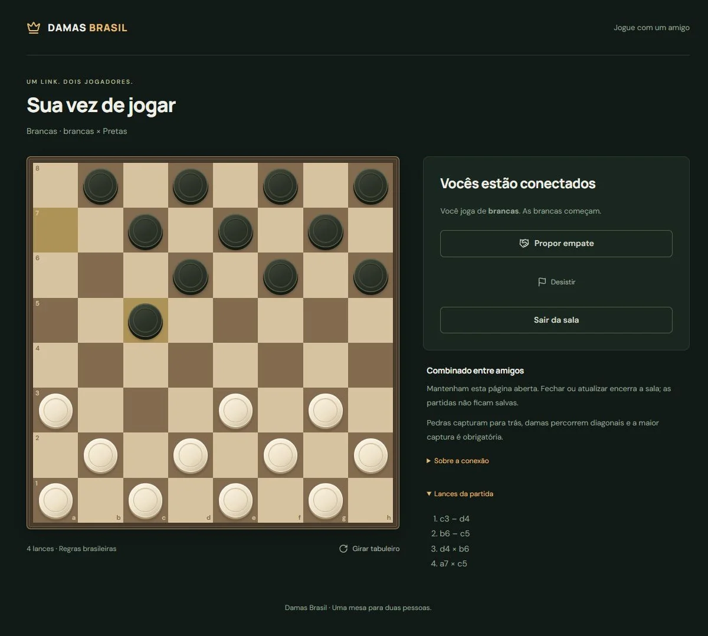

# Depois que eu te conto, de quem é o segredo?

Sou o Stanley, fundador e engenheiro de software. Imagina mandar uma prévia do seu trabalho em particular e, dias depois, ver o link rodando num grupo que você nem conhece.

Há mais de um ano construo sozinho o **Lynkyz**, uma rede social para criadores e para quem acompanha o trabalho deles. Ela foi pensada desde a primeira linha pra que a resposta dessa pergunta continue sendo "seu".

## O palco já está montado

<picture>
  <source media="(max-width: 950px)" srcset="./assets/lynkyz-numeros-vertical.svg">
  
</picture>

O cartaz diz passagem de som porque o Lynkyz ainda não abriu as portas. Atrás da cortina já tem bastante coisa ligada:

- **Feed, stories e comunidades**, pra quem cria publicar e pra quem acompanha encontrar.
- **Chat e notificações em tempo real**, com presença de quem está online.
- **Marketplace**, com pedidos e o cálculo de quanto cada criador recebe.
- **Mídia protegida**, com upload verificado, links que expiram e uma marca por cópia entregue.
- **Moderação**, com denúncia, evidência preservada e restrição que acompanha o arquivo.
- **Busca, métricas para quem cria e um painel de operação.**

São 18 módulos no backend, mais de 2.000 testes automatizados e mais de 80 mil linhas de código, sem contar os testes.

## O que já caiu pelo caminho

- **Tempo real que funcionava até abrir dois navegadores.** Achei uma fila de defeitos que só aparecia com duas pessoas conversando de verdade. Consertei um por um.
- **Dinheiro não pode sumir no meio do caminho.** Cada evento financeiro fica registrado antes de ser processado. Se algo cair na metade, ele volta de onde parou.
- **Troquei a biblioteca de interface inteira com a obra em andamento** e desenhei um design system próprio no lugar.
- **Montei a operação toda**: containers, backup, monitoramento e alertas.
- **Cada módulo tem a sua documentação.** Um script reclama quando o código muda e ela não.

## Aurora

A Aurora é o jeito de pensar segurança do Lynkyz. Quando a moderação restringe um arquivo denunciado, a cópia idêntica não sobe de novo. Quem foi afetado não precisa denunciar tudo outra vez.

[Veja o que a Aurora já faz →](https://github.com/SeedetY/Aurora)

## Minha pedaleira de código

<picture>
  <source media="(max-width: 950px)" srcset="./assets/pedaleira-vertical.svg">
  
</picture>

Aprendi **Python** por causa do Django e **TypeScript** pra trabalhar com React e Next.js. Também escrevo **JavaScript** no navegador.

Atrás do palco fica o resto do equipamento. No servidor, **PostgreSQL**, **Redis**, **Elasticsearch**, **Celery** e WebSockets com **Django Channels**. Na interface, **Tailwind**, **React Query** e **Zustand**, com testes em **Vitest**. Na operação, **Docker**, **Caddy**, **Prometheus**, **Grafana** e **Sentry**.

## Damas Brasil

Fiz o **Damas Brasil** pra uma partida caber num “bora?”. Você abre uma sala no navegador e manda o convite. Sem cadastro. Um dia quero ver uma final de campeonato ali, com a torcida inteira jurando que viu uma jogada melhor.



Partida de demonstração depois de quatro lances, com duas capturas anotadas ao lado do tabuleiro.

[Abra uma mesa de damas →](https://damas-lilac.vercel.app/)

### A partida que eu quero perder

Um dia quero treinar uma IA de damas com as minhas próprias partidas. O teste vai ser quando ela me oferecer uma peça e eu cair na minha própria armadilha. Se acontecer, já quero a revanche.

## Próximas datas da turnê

- **Lynkyz** abre as portas para os primeiros criadores.
- **Aurora** sai de dentro do Lynkyz e vira produto próprio.
- **Damas Brasil** ganha uma IA que joga como gente, ou que simplesmente não perde.

<details>
<summary><strong>Mas quem deu acesso total ao gato?</strong></summary>

```text
NOME NO CRACHÁ    O gato
ACESSO PEDIDO     Total
QUEM AUTORIZOU    O próprio gato
```

Pedido negado. Dormir em cima do amplificador continua liberado.

</details>
