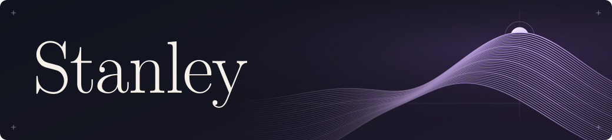

# Founder & CEO · Software engineer

I’m Stanley. I decide what to build and write the software behind it. I’m interested in how much control creators keep over their work after they hit **Publish**.

## Project Aurora

I started Aurora to explore cybersecurity for the creator economy, where a single account can be both a workspace and a livelihood.

[View Aurora on GitHub →](https://github.com/SeedetY/Aurora)

## How I think about engineering

- **Access control** — Does a forwarded link still respect the creator’s choice of audience?
- **Reliability** — If a request succeeds but the response never arrives, can the client safely retry?
- **Privacy** — Can we explain why an action failed without logging someone’s private content?
