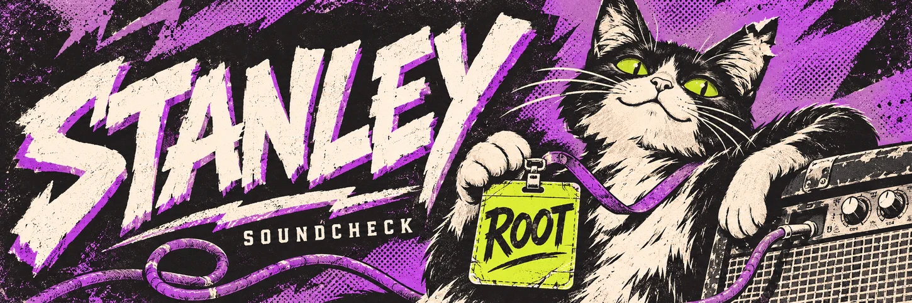

# Who gave the cat root?

I’m Stanley. I start software projects and write the code. If you hand me a build, I’ll open it in two accounts and try the one thing the demo politely skipped.

## On the workbench

**[Aurora](https://github.com/SeedetY/Aurora)** is my cybersecurity project for creators. Say a creator shares a private link, then changes their mind. I want to know what happens when the person who kept the link opens it tomorrow.

<details>
<summary><strong>Inspect the cat’s backstage pass</strong></summary>

```text
NAME ON PASS     the cat
REQUESTED ROLE   root
ISSUED BY        the cat
```

Denied. He still gets to sleep on the amp.

</details>

<sub>Chegou até aqui pra conferir o crachá do gato? Pode ficar.</sub>
